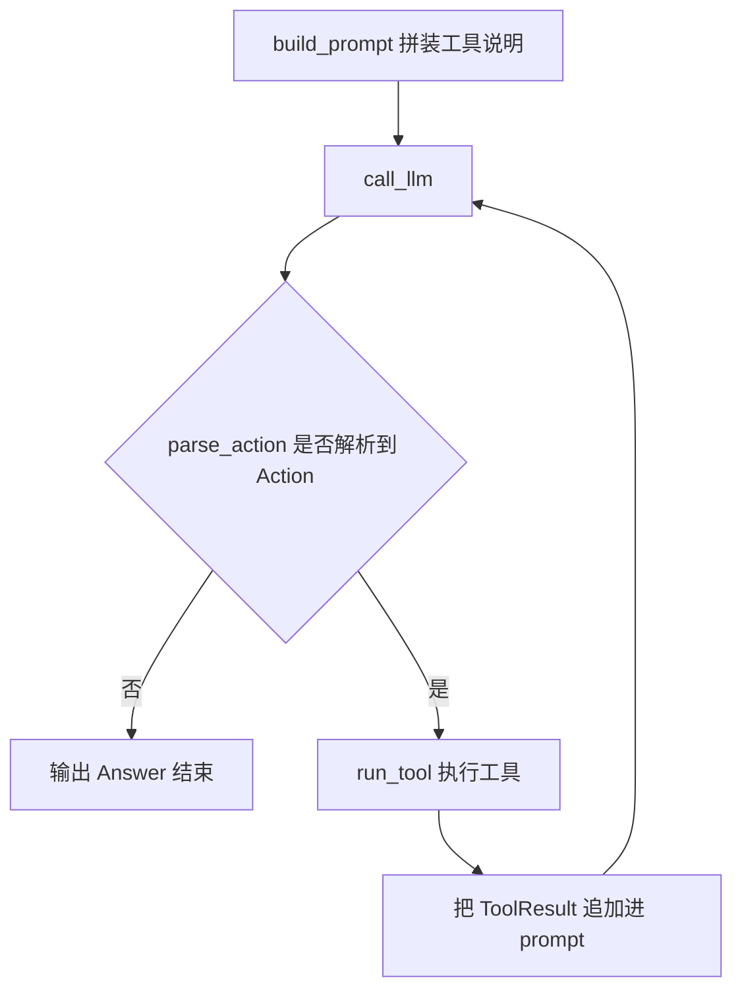

# ReAct Agent

一个手写的 ReAct（Reason + Act）工具调用 Agent：模型按 `Thought / Action / ToolResult / Answer` 文本格式发起工具调用，本地解析并执行工具，把结果回填到提示词中继续下一轮，直到得到最终答案。

不依赖 LangChain / AutoGen 等框架，核心逻辑集中在 [ReAct.py](./ReAct.py)。

## 文件说明

| 文件 | 说明 |
| ---- | ---- |
| [ReAct.py](./ReAct.py) | Agent 主体：工具注册、提示词构建、Action 解析、工具执行与循环控制 |
| [家庭成员兴趣爱好1.md](./家庭成员兴趣爱好1.md) | 供 `read_hobbies_file` 工具读取的兴趣爱好文档 |
| [rag_real_materials_南瓜书练习/](./rag_real_materials_南瓜书练习/) | 用原版《南瓜书》PDF 练 RAG 的材料包与提取脚本 |

## 环境要求

- Python 3.10+（代码使用了 `X | Y` 类型联合语法）
- 依赖：`openai`

```bash
pip install openai
```

模型端点在 `call_llm` 中指向自建 OpenAI 兼容服务（`http://192.168.124.18:18082/v1`，模型 `qwen38-gyro-m`）；密钥仍由 `OpenAI()` 从环境变量 `OPENAI_API_KEY` 读取，换服务时改这两行即可。

```bash
export OPENAI_API_KEY=你的密钥
python ReAct.py
```

## 工作流程



1. `build_prompt`：用 `inspect.signature` 和 `inspect.getdoc` 动态生成工具清单，不需要手写工具描述。
2. `call_llm`：以 `stop=["ToolResult:"]` 截断，模型输出到 `ToolResult:` 即停止，等待本地执行工具。
3. `parse_action`：用 `ast.parse(mode="eval")` 解析 `Action: 函数名(参数名=字面量, ...)`，只接受显式命名参数，参数值经 `ast.literal_eval` 还原，避免 `eval` 执行任意代码。
4. `run_tool`：先用 `inspect.signature(...).bind()` 校验参数，再调用注册表中的函数。
5. `agent_loop`：最多 `max_steps` 次工具调用；达到上限时把「不能再调用工具」的提示词回填，让模型基于已有工具结果直接给出答案。解析或执行报错时，把错误原文回填提示词让模型自行修正重试。

## 内置工具

| 工具 | 参数 | 作用 |
| ---- | ---- | ---- |
| `query_family_tree` | `name`, `relationship` | 查询 `FAMILY_TREE` 中的亲属关系 |
| `read_hobbies_file` | 无 | 读取兴趣爱好文档全文 |
| `list_family_members` | 无 | 列出族谱中所有成员 |
| `example_action` | `value` | 回显参数，演示工具调用格式 |

## 添加自己的工具

加一个 `@register_tool` 装饰器即可，提示词与参数校验会自动生效：

```python
from ReAct import register_tool

@register_tool
def query_weather(city: str) -> str:
    """查询城市天气；提供 city（城市名）。"""
    return f"{city} 晴"
```

文档字符串会直接进入工具清单，写清楚参数含义能明显提高模型选对工具的概率。

## RAG 材料提取流程（rag_real_materials_南瓜书练习）

用原版《南瓜书》PDF 当被检索的知识库，先做「把文档变成可检索文本」这一步。详见该目录下的 [README_先读我.md](./rag_real_materials_南瓜书练习/README_先读我.md) 与 [来源与许可.txt](./rag_real_materials_南瓜书练习/来源与许可.txt)。

```bash
pip install pymupdf
# 脚本内用的是相对仓库上一级的路径，需在 LocalAgent 目录下运行
python human_code/rag_real_materials_南瓜书练习/extract_pages.py
```

流程（[extract_pages.py](./rag_real_materials_南瓜书练习/extract_pages.py)）：

1. `pymupdf as fitz` 导入，兼容旧包名 `fitz`。
2. `fitz.open(...)` 打开 PDF，`page.get_text("text")` 逐页提取正文，`enumerate(doc, start=1)` 保留从 1 开始的 PDF 页码，页码写进每条记录而不是只打印一次。
3. 打印总页数（196 页），并取出 `pages[17]` 即 PDF 第 18 页（纸面第 5 页，2.2「评估方法」）作为第一题的证据页。
4. `json.dump(..., ensure_ascii=False, indent=2)` 写出 `pages.json`，中文保持可读。

### 三种解析库的切片对比

[chunk_three_ways.py](./rag_real_materials_南瓜书练习/chunk_three_ways.py) 用同一本 PDF 分别跑 MinerU、Docling、PyMuPDF4LLM，结果各存一个文件：`chunks_mineru.json`、`chunks_docling.json`、`chunks_pymupdf4llm.json`。

需要独立环境（三个包都会拉 torch/onnxruntime，不要装进主 `.venv`）：

```bash
cd /Users/ruanwen/PycharmProjects/LocalAgent
uv venv --python 3.13 human_code/.venv-slice
uv pip install --python human_code/.venv-slice/bin/python mineru docling pymupdf4llm
human_code/.venv-slice/bin/mineru-kit models download --tier basic --small-backend torch
human_code/.venv-slice/bin/mineru config set parse_server.local.managed_tier basic
human_code/.venv-slice/bin/mineru config set parse_server.local.mode managed

# 全书 196 页，或先用 --pages 18-19 快速验证
human_code/.venv-slice/bin/python human_code/rag_real_materials_南瓜书练习/chunk_three_ways.py
```

三个方案对「切片」的处理并不等价，横向比较时要记住差异：

| 方案 | 解析 | 切块 | 页码来源 |
| ---- | ---- | ---- | ---- |
| MinerU | CLI 输出整页 markdown（公式转 LaTeX、表格还原、页眉页脚剔除） | 自身不切块，脚本按 `<!-- page N of M -->` 还原页码后复用贪心切句逻辑 | 页标记 |
| Docling | 自带版面/表格模型 | `HybridChunker(max_tokens=400)`，块可跨页 | `doc_items[].prov[].page_no` |
| PyMuPDF4LLM | layout 模式（GNN 版面 + RapidOCR） | 自带 `to_chunks(max_tokens=400)`，块可跨页 | `metadata.page_start/page_end` |

全书 196 页实测（目标片长约 400 字，Apple Silicon 本机）：

| 方案 | 片数 | 总字符 | 平均片长 | 最长片 | 用时 | 备注 |
| ---- | ---- | ---- | ---- | ---- | ---- | ---- |
| MinerU | 2103 | 652873 | 310 | 400 | 1075s | 正文最干净（公式转 LaTeX、表格还原），但最慢，且片数最多 |
| Docling | 735 | 247027 | 336 | 1423 | 68s | 目录页等表格整块保留，所以片数最少 |
| PyMuPDF4LLM | 949 | 294235 | 310 | 4558 | 34s | 最快；目录页表格整块保留，故最长片偏大 |

三者都完整覆盖 196 页，第 18 页「留出法 / 交叉验证法 / 自助法」这句证据在三个方案里都落在同一个片内（`mineru-p018-c04`、`docling-p018-c04`、`pymupdf4llm-p018-c05`）。Docling 与 PyMuPDF4LLM 分别有 105、99 个跨页片，做「按页引用」时要用 `page_start`/`page_end` 而不是单一 `pdf_page`。

几个踩过的坑：

- MinerU 4.x 的 `parse` 走本地服务，必须先 `mineru server start`；`config set parse_server.local.mode managed` 会先校验模型文件是否就绪，所以顺序是「下模型 → 设 tier → 设 mode」。
- `mineru parse --json` 写出的文件其实是 markdown，页码结构只在 `<!-- page N of M -->` 注释里；`--no-marker` 会连页码一起删掉。
- `pymupdf4llm.to_chunks` 不开 `use_layout(True)` 会抛 `NotImplementedError`；它的 `pages` 参数是 0 基。
- Docling 的 API 名和直觉不一致：`ConversionResult.document`（不是 `.result`）、`export_to_markdown`、`DocItem.prov`（不是 `.provenance`）。
- MinerU 会把公式还原成 LaTeX 源码，第 18 页 7281 字符里 5633 是公式、正文只有 1648（`pages.json` 同页 1577）。也就是说它的 400 字预算大量被公式吃掉，公式密集页的正文反而被切得更碎（第 18 页 20 片 vs Docling 5 片）。全书总字符 65 万 vs `pages.json` 的 29 万，差值主要来自 LaTeX 与表格 markdown。
- 一次请求覆盖整本书会让 parse-server 在健康检查时被重启，CLI 轮询随即断连（`Local parse-server transport failed ... ConnectError`）。脚本按 20 页一批解析并带 3 次重试。
- PyMuPDF4LLM 的 `max_tokens` 默认按「4 字符 ≈ 1 token」估算，中文约 1 字符 ≈ 1 token，不传 `tokenizer` 时片长会是另外两个方案的约 4 倍。脚本传 `tokenizer=lambda text: len(text)` 统一口径。

后续按说明继续做 500 字/重叠 50 字的切分、jieba + rank-bm25 检索，以及自写五道题标注证据页后统计 hit@3。

`pumpkin_book.pdf`（约 4 MB，CC BY-NC-SA 4.0）体积较大且已写入 `.gitignore`，未入库；按说明中的原始链接自行下载，再分发需保留署名与相同许可。

### BM25 检索与问答

[search_bm25.py](./rag_real_materials_南瓜书练习/search_bm25.py) 用 `chunks.json`（857 片）做 BM25 检索，`tokenize` / `load_chunks` / `build_index` / `search` 是同一套分词，语料与查询不能各用一套。

```bash
python search_bm25.py "哪三种模型评估方法？"          # 只检索，打印前 3 条
python search_bm25.py --rag "书中介绍了哪三种模型评估方法？"   # 检索前 3 条后交给模型作答
```

`--rag` 走 `answer_with_rag`：取 `search()` 的前 3 条（带 `text`、`pdf_page`、`chunk_id`、`score`），连同问题交给 `call_llm`。提示词要求只依据给定片段、标明来源页码、证据不足时明确说「资料不足，无法回答」。模型接口与 [ReAct.py](./ReAct.py) 一致（`OpenAI()` + `base_url` 指向 `18082`），没有搬 ReAct 的工具循环。

### 向量检索与 BM25 对照

[embed_chunks.py](./rag_real_materials_南瓜书练习/embed_chunks.py) 把 857 片批量向量化（batch 32，实测约 700s），按行 L2 归一化后存 `chunk_vectors.npy`（857×1024 float32）与 `chunk_vector_ids.json`。这两个产物加 `chunk_vectors.npz` 体积约 3.4 MB，已写入 `.gitignore`，可用脚本重算。

[compare_bm25_vs_vector.py](./rag_real_materials_南瓜书练习/compare_bm25_vs_vector.py) 对同一批问题分别跑 BM25（复用 `search`，`top_k=3`）与 NumPy 余弦检索（`matrix @ query_vector`），两边证据各自喂给同一个 `call_llm`，便于横向比较。

[BM25_向量_RRF对照.ipynb](./rag_real_materials_南瓜书练习/BM25_向量_RRF对照.ipynb) 在此基础上加 RRF（倒数排名融合，`1/(60+名次)`）：BM25 分数是 19 量级、余弦相似度是 0.6 量级，不是同一把尺子，不能直接相加，只看名次才叫融合。笔记第一格从 `human_code/.env` 读 `EMBED_BASE_URL` / `EMBED_API_MODEL`，必须在定义这两个变量的格子之前运行。

### 本地服务与环境变量

`.env` 已在 `.gitignore` 内，不入库；需要自行填写：

| 变量 | 值 | 说明 |
| ---- | ---- | ---- |
| `EMBED_BASE_URL` | `http://192.168.124.18:8090/v1` | embedding 端点，OpenAI 兼容，`/v1/embeddings` 与 `/embeddings` 都可用 |
| `EMBED_API_MODEL` | `qwen3-embedding-0.6b` | 输出 1024 维 |
| `EMBEDDING_API_KEY` / `OPENAI_API_KEY` | 8090 的 key | `OpenAI()` 只认 `OPENAI_API_KEY`，8090 校验它 |
| `QDRANT_API_KEY` | Qdrant 的 key | 当前脚本用 NumPy，暂不连 Qdrant |

几个实测结论：

- `18082` 只有聊天模型，`/v1/embeddings` 返回 `not found`；embedding 必须打 `8090`。
- `18082` 不校验 key，`OPENAI_API_KEY=""` 就能通过 SDK 的本地校验；`8090` 和 Qdrant 都真校验，占位值会被拒。
- Qdrant 1.10.1：REST `6333` 检索路径是 `/collections/<name>/points/search`（少 `/points` 会 404）；gRPC 构造要写 `port=6333, grpc_port=6334, prefer_grpc=True`，写成 `port=6334` 会报 `illegal request line`。
- 无关问题（如「小明的哥哥有什么兴趣爱好」）BM25 仍会排序给出 top3，但余弦分数只有 0.27～0.30，明显低于正常命中的 0.63～0.76，可以当「资料不足」的阈值；两种检索下模型都正确回答「资料不足，无法回答」。
- 口语化改写的问题（「用哪几种办法检验模型表现」vs 书里的「评估方法」）BM25 会被同形词带到 2.4「比较检验」，向量检索能打到第 18 页的三种评估方法。单路都有盲区，RRF 融合在实测的第 4 题里没把目标片段带进前 3。

## 已知限制

- `read_hobbies_file` 读取的文件名是 `家庭成员兴趣爱好.md`，仓库内实际文件是 `家庭成员兴趣爱好1.md`，两者不一致时该工具会抛 `FileNotFoundError`。
- 提示词是单条字符串累积拼接，没有独立的对话历史结构，长任务会一直变长。
- 工具在本机同步执行，没有并发与超时控制。

## 学习复盘

1. `raise` 和 `return`区别：`raise`直接退出程序，`return` 是将错误或者预定的内容返回
2. 工具失败现在是直接将程序错误信息返回给模型，让模型自行根据错误修改请求模型的参数，纠错次数是基于昨天的最大工具调用次数，现在达到最大单次重试后会返回对应的提示词给模型
3. 已增加 Answer 关键词作为最终回复的标记 json校验没有验证现在模型应该不太会出现问题了，当然是我偷懒的借口
4. 这个做在工具侧感觉我这两个工具不太好写，我感觉还是比较简单，顺便这里有一个问题，codex 等 agent 工具调用时往往还会做别的事，这种类似异步的操作我们要手动实现吗，我感觉我能理解一些简单的实现方式，但是什么时候插入上下文的这个编排感觉没有一个很好的思路
5. 1、 正常输出；2、只知道关系不知道爱好且告知文件不存在；3、没写 ； 4、没遇到 5、没遇到 6、实验没做，但是知道模型会说次数到了，让我检查相关的东西
