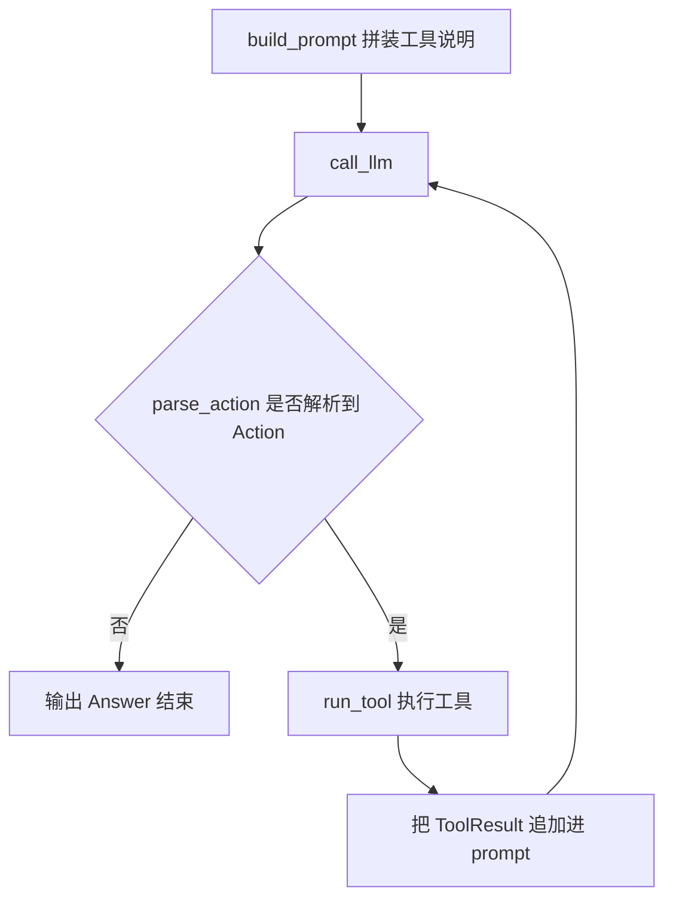

# ReAct Agent

一个手写的 ReAct（Reason + Act）工具调用 Agent：模型按 `Thought / Action / ToolResult / Answer` 文本格式发起工具调用，本地解析并执行工具，把结果回填到提示词中继续下一轮，直到得到最终答案。

不依赖 LangChain / AutoGen 等框架，核心逻辑集中在 [ReAct.py](./ReAct.py)。

## 文件说明

| 文件 | 说明 |
| ---- | ---- |
| [ReAct.py](./ReAct.py) | Agent 主体：工具注册、提示词构建、Action 解析、工具执行与循环控制 |
| [家庭成员兴趣爱好1.md](./家庭成员兴趣爱好1.md) | 供 `read_hobbies_file` 工具读取的兴趣爱好文档 |

## 环境要求

- Python 3.10+（代码使用了 `X | Y` 类型联合语法）
- 依赖：`openai`

```bash
pip install openai
```

模型端点在 `call_llm` 中指向自建 OpenAI 兼容服务（`http://192.168.124.18:18082/v1`，模型 `qwen38-gyro-m`）；密钥仍由 `OpenAI()` 从环境变量 `OPENAI_API_KEY` 读取，换服务时改这两行即可。

```bash
export OPENAI_API_KEY=你的密钥
python ReAct.py
```

## 工作流程



1. `build_prompt`：用 `inspect.signature` 和 `inspect.getdoc` 动态生成工具清单，不需要手写工具描述。
2. `call_llm`：以 `stop=["ToolResult:"]` 截断，模型输出到 `ToolResult:` 即停止，等待本地执行工具。
3. `parse_action`：用 `ast.parse(mode="eval")` 解析 `Action: 函数名(参数名=字面量, ...)`，只接受显式命名参数，参数值经 `ast.literal_eval` 还原，避免 `eval` 执行任意代码。
4. `run_tool`：先用 `inspect.signature(...).bind()` 校验参数，再调用注册表中的函数。
5. `agent_loop`：最多 `max_steps` 次工具调用；达到上限时把「不能再调用工具」的提示词回填，让模型基于已有工具结果直接给出答案。解析或执行报错时，把错误原文回填提示词让模型自行修正重试。

## 内置工具

| 工具 | 参数 | 作用 |
| ---- | ---- | ---- |
| `query_family_tree` | `name`, `relationship` | 查询 `FAMILY_TREE` 中的亲属关系 |
| `read_hobbies_file` | 无 | 读取兴趣爱好文档全文 |
| `list_family_members` | 无 | 列出族谱中所有成员 |
| `example_action` | `value` | 回显参数，演示工具调用格式 |

## 添加自己的工具

加一个 `@register_tool` 装饰器即可，提示词与参数校验会自动生效：

```python
from ReAct import register_tool

@register_tool
def query_weather(city: str) -> str:
    """查询城市天气；提供 city（城市名）。"""
    return f"{city} 晴"
```

文档字符串会直接进入工具清单，写清楚参数含义能明显提高模型选对工具的概率。

## 已知限制

- `read_hobbies_file` 读取的文件名是 `家庭成员兴趣爱好.md`，仓库内实际文件是 `家庭成员兴趣爱好1.md`，两者不一致时该工具会抛 `FileNotFoundError`。
- 提示词是单条字符串累积拼接，没有独立的对话历史结构，长任务会一直变长。
- 工具在本机同步执行，没有并发与超时控制。

## 学习复盘

1. `raise` 和 `return`区别：`raise`直接退出程序，`return` 是将错误或者预定的内容返回
2. 工具失败现在是直接将程序错误信息返回给模型，让模型自行根据错误修改请求模型的参数，纠错次数是基于昨天的最大工具调用次数，现在达到最大单次重试后会返回对应的提示词给模型
3. 已增加 Answer 关键词作为最终回复的标记 json校验没有验证现在模型应该不太会出现问题了，当然是我偷懒的借口
4. 这个做在工具侧感觉我这两个工具不太好写，我感觉还是比较简单，顺便这里有一个问题，codex 等 agent 工具调用时往往还会做别的事，这种类似异步的操作我们要手动实现吗，我感觉我能理解一些简单的实现方式，但是什么时候插入上下文的这个编排感觉没有一个很好的思路
5. 1、 正常输出；2、只知道关系不知道爱好且告知文件不存在；3、没写 ； 4、没遇到 5、没遇到 6、实验没做，但是知道模型会说次数到了，让我检查相关的东西
